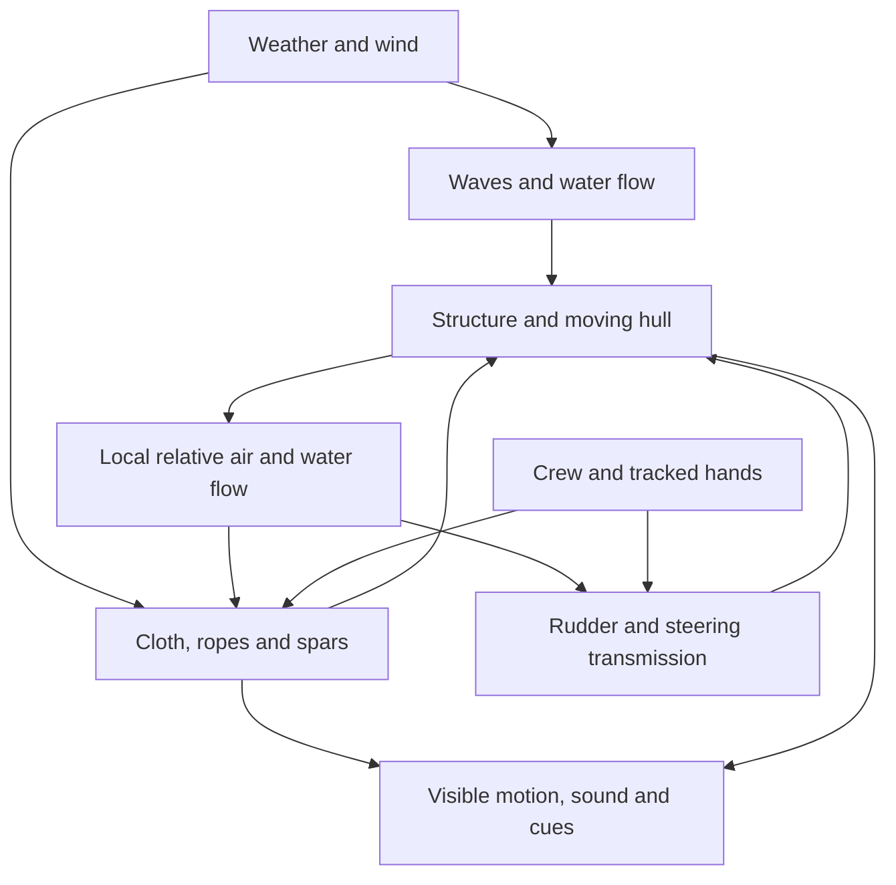

# APEX: immersive ship simulation prerequisites

**Purpose:** a reusable, first-person sailing and historical naval-game simulation that can grow into an evidence-backed VR training demonstrator. The ship, crew, rig, atmosphere and water must produce one consistent physical response. Interface improvements expose those systems; they cannot substitute for them.

**Current readiness: prototype. No whole-ship realism or headset-training gate below is accepted.** One fore sail has a coarse membrane, two sheets and a braced yard. Seven sails still use fixed pressure surfaces with cosmetic flutter. The hull/helm, environment, co-op and lesson have useful tested prototypes; material constants, full rigging, structural failure and real headset acceptance remain incomplete.

This is the canonical readiness checklist. Older dated entries in `SHIP_ENGINEERING_CHECKLIST.md` describe implementation milestones, not completion of these prerequisites. Preserve the original ship and preferred wheel while improving the simulation.

## What counts as finished

A prerequisite closes only when its applicable mechanisms are inventoried, its assumptions are declared, its tests pass, and its behavior has been inspected in a rendered build. Quantitative handling additionally needs reference measurements and agreed tolerances. VR prerequisites additionally need named physical headsets/controllers and device recordings. A successful import, screenshot, convincing animation, CI run or controller-math test alone does not close a realism gate.

Use these status labels in evidence records: **partial** (some model exists), **missing** (required implementation absent), **unverified** (implementation has not passed the relevant acceptance), **accepted** (all scoped evidence recorded). None of the complete gates currently qualifies as accepted.

Every acceptance record must name: requirement ID, source commit, scenario/seed, units and parameters, reference data or analytical solution, tolerances, measured results, test/log paths, rendered evidence, hardware/runtime, reviewer, and known limits. Proposed thresholds are not physical validation until their reference and rationale are recorded.

“Full” means complete for a declared vessel and operating envelope, including failures that matter to its tasks. It does not require a molecular model of wood or a global weather forecast. An intact compound hull, a structural connection graph, calibrated hydrodynamic models and deformable rigging can provide the necessary behavior at real-time rates. The resulting observables and load paths still have to be verified.

## Readiness overview

| Gate | Required result | Present position |
| --- | --- | --- |
| R0: reference and inventory | One coherent vessel configuration and complete part/action/load-path register | Open: historically inspired pinnace; measured historical profile not selected |
| R1: structural vessel | Correct mass, stiffness, connections, damage and watertight openings | Partial shell/collision; no validated structural graph |
| R2: water and handling | Verified hydrostatics, dynamic response, currents and maneuvering | Partial six-degree force model; provisional parameters |
| R3: atmosphere and sea | Coherent wind, weather history, waves and water motion | Partial seeded field and shared CPU/GPU sea; no calibrated weather/sea envelope |
| R4: cloth and air | All sails drape, fill, luff, backwind, reef and furl from loads/constraints | One coarse membrane; seven fixed pressure surfaces; contact and full range open |
| R5: ropes and machinery | Complete working rig, mechanical advantage, friction, slack and failure | Wheel transmission and two fore circuits only; ideal leads/lumped ropes |
| R6: crew and onboard actions | Every required action can be performed at real fittings | Five station adapters and introductory solo lesson; most shipboard work absent |
| R7: combat and damage | Combat loads alter the same structure, rig and handling | Not implemented as an integrated naval-combat model |
| R8: true VR operation | Tracked reach, physical interactions, reliable controls and device frame budget | Experimental WebXR adapter; no physical headset acceptance |
| R9: UX and sensory coherence | Readable, contextual controls and effects that agree with physics | Interface revision in progress; device usability unverified |
| R10: shared simulation | Multiple crew operate one authoritative physical ship reliably | Small co-op prototype; public service and scale acceptance open |
| R11: training and reuse | Reviewed procedures, measurable learning, reproducible portable asset package | Introductory sequence and reusable cores; training transfer/package not validated |

## R0 — reference, configuration and system contracts

- [ ] **REF-01 · Vessel profile.** Record hull form, date/region, dimensions, displacement, rig, steering arrangement, deck/interior plans, crew complement and equipment. Attach original sources and confidence per parameter. Keep the preferred wheel in the current trainer; an eventual strict medieval variant needs its own coherent references rather than a different label on the same ship.
- [ ] **REF-02 · Complete inventory.** Give every structural member, sail, spar, rope circuit, block, fastening, opening, machine and station a stable ID, material, dimensions, mass/inertia or aggregation rule, sockets, allowable motion and failure modes. No unnamed mechanical dependency may silently disappear between asset and simulation.
- [ ] **REF-03 · Action register.** For every operation, record required crew/tools, reach, starting state, order, force/rate limits, observable motion, neighboring effects, completion state, mistakes and recovery. Map each to desktop/touch and VR adapters. An animation or abstract “sail amount” slider cannot satisfy an operation such as hoisting, reefing or furling.
- [ ] **REF-04 · Unit and coordinate contract.** SI units, common world clock, bow/port/starboard convention, rest and deformed geometry, center-of-mass frame and consistent force/moment signs. Test translated/rotated instances and metric imports; avoid hidden scale-dependent spring or hand-force behavior.
- [ ] **REF-05 · Model boundaries.** List resolved versus approximated behavior, operating envelope, simulation/render LOD, provisional parameters and intentionally omitted equipment. Visual detail must not be reported as a solved physical degree of freedom.
- [ ] **REF-06 · Reference hierarchy.** Use period-matched plans, archaeological/conservation evidence and operating practice where available; document later sources used only for terminology or mechanism examples. Material-property assumptions and uncertainty belong in a versioned calibration ledger.

## R1 — structure, mass and watertight integrity

- [ ] **STR-01 · Hull and interior geometry.** Closed displacement envelope, correct stem/stern/keel, decks, frames, beams, knees, mast steps and penetrations. Mesh topology checks and deck/interior traversals must agree with rendered dimensions. Current refit/collision tests cover only part of this requirement.
- [ ] **STR-02 · Mass ledger.** Aggregate timber, rig, sails, fittings, cargo, ballast, crew and water exactly once into mass, center of mass and inertia. Moving cargo/crew and shipped water must alter stability. The present 80 t rigid assembly and box inertia remain estimates.
- [ ] **STR-03 · Connection graph.** Planks/frames/beams/keel and rig attachments need explicit load-bearing connections, capacities and compliance. Trace a known test load through connections to the hull; severing a connection must remove the appropriate support path.
- [ ] **STR-04 · Elastic and failure behavior.** Represent relevant timber bending, fastener slip/pullout, spar buckling/fracture and progressive loss of support. Test declared material directionality and failure envelopes against chosen references. Every visible plank need not run as an independent rigid body while the vessel is intact.
- [ ] **STR-05 · Collision and contact.** Hull, shore/seabed, spars, rig, crew, cargo and detached pieces require appropriate collision layers and nonpenetration. Contact impulses must reach the same mass/structure model; use swept checks where speed would otherwise tunnel.
- [ ] **STR-06 · Damage-to-aperture coupling.** Damage opens a geometrically located leak path instead of merely subtracting hit points. Open/closed hatches and ports affect water entry; repairing them changes the real connection/opening state.
- [ ] **STR-07 · Detachment accounting.** Broken islands become physical bodies with transferred mass, inertia, velocity and connected rigging. Check momentum/mass before and after separation and prevent duplicate buoyancy or retained phantom supports.
- [ ] **STR-08 · Working structure under load.** Mast partners/steps, chainplates, deadeyes/lanyards, deck fittings, belaying rails and steering supports must carry their actual rig/crew loads. A line should not be attached to an infinitely strong decorative point without that approximation being declared.

## R2 — hydrostatics, flooding and maneuvering

- [ ] **HYD-01 · Displacement and equilibrium.** Compare immersed volume/center of buoyancy with analytical cases and the selected vessel across draft, heel and trim. Current column integration has numerical reference tests, not an authenticated vessel waterline.
- [ ] **HYD-02 · Stability curve.** Verify righting arm/moment through the relevant heel range, downflooding, loss of stability and capsize, including cargo/crew movement and free-surface water. A small-angle restoring response is insufficient evidence for full stability.
- [ ] **HYD-03 · Dynamic water loads.** Calibrated resistance, lateral flow/leeway, added-mass/radiation effects as needed, wave excitation, roll damping and hull slamming. Measure response in defined wave/current cases; do not call empirical damping a complete hydrodynamic solution.
- [ ] **HYD-04 · Rudder envelope.** Load depends on actual local water velocity, blade angle, immersion, reverse flow and relevant stall/ventilation. Verify negligible authority without flow, force reversal when appropriate, hinge torque and hull reaction without assigning heading directly.
- [ ] **HYD-05 · Maneuvering data.** Match declared reference acceleration, leeway, turning behavior, stopping/drifting response and response to reduced canvas. Establish error bands from reference quality rather than inventing a “realistic” speed curve.
- [ ] **HYD-06 · Flooding network.** Aperture area/head, interconnected spaces, trapped/vented air where relevant, interior water levels and free-surface moments. A submerged breach admits water; an equivalent opening above the sea should not. Current three-compartment inflow is a simplified starting point.
- [ ] **HYD-07 · Pumps and repairs.** Pump displacement, gearing/effort, losses, crew operation, intake availability and discharge location determine real water removal. Test pumping against a continuing leak and degraded equipment; a button granting an arbitrary volume reduction does not close this gate.
- [ ] **HYD-08 · Coast and depth.** Bathymetry, grounding, shoaling/breaking and bottom contact affect the relevant scenarios. Prevent intact-hull buoyancy from acting through dry land; include shallow-water effects where the training task requires them.

## R3 — natural weather, wind and water as a coupled environment

- [ ] **ENV-01 · Atmosphere state.** Seeded, continuous spatial/temporal wind, gusts, pressure, temperature, humidity and visibility with declared physical/statistical relationships. Current correlated procedural fields are not numerical weather prediction or validated storm dynamics.
- [ ] **ENV-02 · Local apparent wind.** Sample at sail panels, spars and exposed bodies using their actual velocities, including hull rotation and cloth motion. Zero world wind is not zero apparent wind for a moving ship. Test common air/ship translation, shear and a gust crossing the rig.
- [ ] **ENV-03 · Wind history to waves.** Wind strength, duration and fetch must influence sea development and relaxation. Separate swell from local wind sea; avoid instantly changing every wave height when weather is selected. Current lagged sea scaling lacks a calibrated fetch/history model. See source S3.
- [ ] **ENV-04 · Irregular directional sea.** Define spectral energy, directional spreading, multiple swell systems, grouping and reproducible extremes. Validate heights/periods/slopes and evolution statistically against the chosen sea-state envelope, not just an uneven screenshot.
- [ ] **ENV-05 · One physical/rendered surface.** Height, slope, displacement and water velocity queried by hulls, spray/contact and renderer must agree in world space and time. Current CPU/GPU functions share parameters; device-level agreement and boundary cases still need acceptance.
- [ ] **ENV-06 · Currents and tides.** Independent bulk current and tidal/depth fields combine with wave orbital velocities. Test relative flow, anchoring and ground speed versus speed through water; phase must remain shared across clients.
- [ ] **ENV-07 · Ship–water interaction.** Wake, disturbed flow, bow/stern waves, wave impact, spray and deck wash must be coherent with ship motion and energy. Distinguish a visual wake approximation from a solved two-way free-surface response; select and validate fidelity for the task.
- [ ] **ENV-08 · Breaking and foam.** Breaking criteria, foam generation, advection, decay, crest coverage and wake contribution should follow the declared water model. Foam must move/age plausibly rather than remain painted on a phase-independent surface.
- [ ] **ENV-09 · Precipitation and exposure.** Rain/spray accumulation, material wetness, canvas/rope mass and friction changes, drainage and visibility must connect to the ship. Thunder/lightning sound/flash timing should share an event and position. Snow, ice, strike damage and fire remain explicitly out of scope until included in a named scenario profile.
- [ ] **ENV-10 · Lighting and observation.** Day/night, sky, fog, sea visibility, relevant navigation lights/signals and directional audio agree with the environment. Celestial navigation requires actual location/date/astronomy rather than an arbitrary sky clock.
- [ ] **ENV-11 · Complete scenario suite.** Still air/flat water, calm with residual swell, light breeze, steady reach, gust/front, lull, backing/veering wind, cross sea, storm, poor visibility and recovery. Preserve conditions during replay and include extreme-but-supported combinations without numerical failure.

## R4 — every sail behaves as fabric

- [ ] **SAIL-01 · Zero-apparent-wind drape.** With the ship/yard stationary and slack sheets, remove air forcing and let gravity and fabric constraints determine shape. Inflated camber must relax appropriately; head attachments remain fixed and free cloth hangs/folds. A taut sail may remain tensioned by its ropes. The existing zero-power damping test sets gravity to zero and does **not** establish gravity draping realism. An [isolated normal-gravity measurement](docs/realism/zero-wind-probe.json) records coarse-model settling; cut-shape, folds/contact and reference acceptance are still open.
- [ ] **SAIL-02 · Cut shape and fabric properties.** Separate flat/cut rest geometry from wind-inflated geometry. Use measured/provisional areal mass, warp/weft stretch, shear, bending, seams, bolt ropes and damping with consistent units. A pre-billowed mesh must not silently encode permanent inflation into rest constraints.
- [ ] **SAIL-03 · Fill, lull and refill.** Under a controlled wind ramp the cloth fills; a lull changes pressure/shape; renewed wind refills it without a canned animation or discontinuous force jump. Compare shape, attachment loads and settling time with selected reference footage/data.
- [ ] **SAIL-04 · Luffing and flutter.** Leading-edge unloading, wrinkles, flapping and transient loads respond to changing incidence/tension, including light wind and a failed trim. Cosmetic vertex oscillation is not proof of this behavior.
- [ ] **SAIL-05 · Backwinding and gybe/tack transitions.** Reverse panel pressure and verify reversed shape, changed brace/sheet loads, transient shock and recovery. Include low-speed maneuvers, not only steady-state billowing.
- [ ] **SAIL-06 · Contact.** Cloth/spar/mast/deck/rope contact and relevant self-contact prevent penetration and permit folds. Test slack canvas gathering against its yard and released cloth landing on a fitting; no hidden collision-free shortcut for furling.
- [ ] **SAIL-07 · Aerodynamics and interference.** Calibrated lift/drag/separation as required, local incidence, porosity and interaction/shadowing between sails. The current normal-pressure model with a provisional coefficient is an approximation, not verified full sail aerodynamics.
- [ ] **SAIL-08 · Working attachments.** Head lashings, clews, tacks, sheets, leeches and every applicable running line constrain the correct points and transmit load into the spar/rig/hull graph. Present bolt ropes/head lashings are visual trim, not additional solved restraints.
- [ ] **SAIL-09 · Set, hoist, lower, clew up and furl.** Apply the correct lines in the correct sequence; gather/bundle cloth and secure gaskets. The cloth, yard, center of pressure and supported mass must change continuously. “Reef fraction” scaling alone does not represent these operations.
- [ ] **SAIL-10 · Reefing and reduced canvas.** Reef points/earings and the relevant gear create a new attachment configuration and actual exposed geometry. Test incorrect sequencing, unsecured cloth and load changes against the selected rig's procedure.
- [ ] **SAIL-11 · Damage and wet canvas.** Tears, failed seams/attachments, water absorption and repair alter mass, tension paths, porosity and usable area. Damage must not leave an invisible undamaged pressure sail applying thrust.
- [ ] **SAIL-12 · Every sail, every supported configuration.** Extend accepted behavior from one isolated course to all fitted sails, with independent controls and coupled loads. The present one-of-eight physical sail is only the proving case.

## R5 — ropes, rig and mechanical transmission

- [ ] **RIG-01 · Complete reeving plan.** Trace each line from fixed end through attachment points, blocks/fairleads and hauling part to its belay, with period-appropriate names and access. Include applicable sheets, tacks, braces, lifts, halyards/tyes, clewlines/clew-garnets, buntlines, leechlines, reef gear and standing rig. Sources S1/S2 are later-period references, not authentication of the present hull.
- [ ] **RIG-02 · Rope state.** Material length, payout, mass, elasticity, damping, slack, bending/contact and tensile-only behavior. A slack rope must sag/move under gravity and cannot push; a taut rope must have a declared load/extension relationship.
- [ ] **RIG-03 · Blocks and tackles.** Sheave geometry, reeving, moving/fixed blocks, mechanical advantage, friction, efficiency and jam limits. Verify force/displacement ratios with ideal analytical cases, then losses against references. Existing fixed leads do not constitute a general tackle solver.
- [ ] **RIG-04 · Belays, knots and friction.** Secure, release, slip and capstan/belay friction under load with reachable hand motions. Define the level at which knots are abstracted; a realistic belaying task needs more than a toggle if knot/turn technique is being assessed.
- [ ] **RIG-05 · Standing rigging and spars.** Pretension, deadeyes/lanyards, stays/shrouds, mast/yard support and relevant compliance. Break or loosen a member and redistribute the supported load through real remaining paths.
- [ ] **RIG-06 · Loaded running rig.** Hauling one line changes the appropriate yard/sail state while opposing gear constrains motion. Support limited crew effort, backdrive, overload slip, runout and recoil without infinite-force kinematic pulls.
- [ ] **RIG-07 · Steering mechanism.** Wheel/axle/drum, opposing lines, blocks, tiller, rudder stock, bearings and stops form a closed mechanical chain. Load from water reaches the user's virtual hand; broken/slack/jammed components degrade the actual chain. Current lumped steering is a partial implementation pending reference calibration.
- [ ] **RIG-08 · Conservation and simultaneous operation.** No duplicated sail force or fictitious internal thrust. Check hull support plus sail/rope/spar momentum against external air, water, gravity and crew work; vary substeps and solve order to expose coupling errors.
- [ ] **RIG-09 · Failure and recovery.** Cut/part/jam/chafe scenarios, finite stored-energy release, loss of restraint, emergency rigging and repair affect actual state. Test release during a gust and a failed belay; render and authority state must agree.

## R6 — crew, work and onboard systems

- [ ] **CREW-01 · Physical access.** Walk, climb, reach, brace, carry and work on moving decks, stairs, ladders, ratlines and footropes where required. Match collision to visible geometry; no grabbing through floors, walls or inaccessible machinery.
- [ ] **CREW-02 · Human capability model.** Force, grip, reach, working posture, rates, fatigue and multi-person effort are declared. Virtual hands cannot inject unlimited work by teleporting through a handle; a helper provides the same bounded actions as a player.
- [ ] **CREW-03 · Manning and coordination.** Derive crew requirements from the selected rig, simultaneous stations, conditions and task durations. Distinguish minimum maneuvering crew, a watch, full complement and solo assistance. Do not invent a definitive crew count before vessel/task reference work.
- [ ] **CREW-04 · Anchoring and mooring.** Anchor/cable or chain appropriate to the profile, seabed holding/drag, payout/scope, windlass/capstan/pawls/brakes, boat movement and crew effort. Weighing anchor must lift actual load; letting go must release actual restraint.
- [ ] **CREW-05 · Hatches, doors, ports and latches.** Reachable hinge/latch states, obstruction, securing and relevant watertightness. Visual rotation alone cannot satisfy securing a weather opening.
- [ ] **CREW-06 · Cargo, ballast and stores.** Loading, stowage, restraint and shifting affect mass distribution, usable spaces and structural loads. Crew moving a load uses the applicable tackle and deck supports.
- [ ] **CREW-07 · Bilge, pumps, drainage and fire response.** Operable mechanisms, capacity/effort and real fluid/fire state connect to the same damage model. Validate the procedures required for the chosen training scenario.
- [ ] **CREW-08 · Instruments and navigation.** Compass, log, lead/depth sounding, chart/reference position and era-appropriate signals have stated error/lag. Instrument learning requires correct inputs and failure cases, not decorative dials.

## R7 — historical naval game integration

- [ ] **BATTLE-01 · Vessel-appropriate equipment.** Select weapons, protective structure, maneuvering and boarding equipment from the chosen period/profile. Keep the steering-wheel training configuration explicit rather than silently claiming it authenticates a medieval warship.
- [ ] **BATTLE-02 · Mechanical stations.** Any modeled carriage, recoil restraint, tackles, reload/handling tools and crew tasks operate through the same force/access system. AI crews obey station availability, rates and effort limits.
- [ ] **BATTLE-03 · Impacts into structure.** Physical impacts and fire can part rigging, damage spars, disable steering, open leaks and alter handling. Cosmetic destruction or an independent combat hit-point model cannot stand in for those consequences.
- [ ] **BATTLE-04 · Boarding, grappling and contact.** The chosen interactions apply actual constraints/loads to vessels and crew. Prevent artificial towing power, interpenetration and contact-induced energy explosions.
- [ ] **BATTLE-05 · Complete emergency loops.** Demonstrate loss of steering, a spar/rig failure, flooding/repair, reduced canvas and recovery in shared wind/sea conditions. Battle outcomes must remain attributable to the common simulation.

## R8 — true VR operation and performance

- [ ] **VR-01 · Physical devices.** Record headset/runtime/browser or native XR backend, tracked controllers/hands, reference space, reach and session transitions. Passing controller math or rendering a 3D scene in a browser is not headset validation. Current WebXR support is an adapter, not this acceptance.
- [ ] **VR-02 · Grasp and manipulation.** Wheel rim, rope tails, pins, tools and handles have observable nearby affordances, correct grip points, bimanual use where needed, compliant force limits, collision and reliable release/belay. Test both hands and tracking loss on real hardware.
- [ ] **VR-03 · Body/deck tracking.** Head/hand/body spaces remain aligned while the vessel moves and heels. Support declared seated/standing/room-scale behavior, collision/reach limits, recentering and leaving/re-entering XR without teleporting the ship or losing control state.
- [ ] **VR-04 · Feedback limits.** Distinguish visual response, vibration cues and actual sustained force feedback. Ordinary tracked controls do not reproduce a loaded rope pulling the trainee's arms or real wheel torque. Any claim to train physical load handling needs suitable force-feedback equipment and task-specific validation.
- [ ] **VR-05 · Comfort and accessibility.** Evaluate horizon/locomotion options, deck motion, text scale/distance, audio, handedness, reach adjustment and seated access. Comfort options must be disclosed if they alter the experience being assessed, and must not silently alter ship physics.
- [ ] **VR-06 · Device frame budget.** Choose a native refresh target and measure application/compositor timing, physics cost, missed frames, memory and sustained thermals on each target. For illustration, 72 Hz allows 13.89 ms and 90 Hz 11.11 ms per frame; these are budget calculations, not achieved performance claims.
- [ ] **VR-07 · Lifecycle and failure recovery.** Unsupported/denied XR, focus/session loss, controller disconnection, changed reference space and browser/native backend differences release inputs safely and preserve a usable non-VR path. Real-device tests must verify recovery.
- [ ] **VR-08 · In-world instruction and assessment.** Legible prompts at fittings, an accessible instructor/menu path, discoverable actions and instrument readings. No mandatory wall of head-locked text or desktop-only button dependency for a task claimed to work in VR.

## R9 — UX, visual and acoustic coherence

- [ ] **UX-01 · Intentional screen hierarchy.** Start, walking, nearby fitting, engaged station, explanation, menu and completion each have a designed state. Normal play exposes the relevant action; engineering controls have their own deliberate entry. A new panel placed over the old dashboard does not close this gate.
- [ ] **UX-02 · Input parity.** Desktop/touch and VR operate the same mechanism and task conditions with appropriate affordances. Mode transitions, walk-away, release, simultaneous move/look and paused controls must preserve actual state.
- [ ] **UX-03 · Responsive usability.** Inspect landscape/portrait and small landscape screens, text readability, touch sizes, safe areas, occlusion and overlapping targets. Automated geometry checks supplement actual device/usability sessions; they do not prove a layout intuitive.
- [ ] **UX-04 · Visible physical truth.** Cloth, rope endpoints, blocks, rudder, hull/water contact, steering line damage and debris follow solved state. Detail textures, normal maps and decorative lashings must be labeled as such in engineering evidence.
- [ ] **UX-05 · Material and scale cues.** Era-appropriate timber, iron, hemp and canvas, credible dimensions, wear, wetness and shading at hand/eye distance. LOD must not detach functional contact surfaces or obscure which line/fitting can be used.
- [ ] **UX-06 · Sound and tactile cues.** Wind/sail flutter, line/wood strain, blocks, footfalls, impacts, water and weather have positions and event/load relationships. Added cues should help infer real state; they cannot imply a physical load that is not modeled.
- [ ] **UX-07 · Understandable mistakes.** Explain failed reach, an occupied station, an unsecured line, overloaded grip, jam, no rudder flow and unsupported XR. Let the trainee recover through the modeled mechanism; avoid invisible overrides that erase consequences.

## R10 — shared authoritative simulation

- [ ] **NET-01 · Single physical world.** One authority owns hull/rig/environment state and action ordering. Clients receive consistent rope/sail geometry, fittings, crew and clock; they cannot independently apply the same external force twice.
- [ ] **NET-02 · Station ownership and crew work.** Concurrent pulls, handover, disconnection and timeouts have explicit rules and physical outcomes. Existing small-session station arbitration is a prototype, not a full crew/multihand model.
- [ ] **NET-03 · Adverse-network behavior.** Test delay, jitter, loss, reconnection, stalled receivers, contested actions and authoritative correction without impossible impulses or stuck grips. Preserve objective/replay state.
- [ ] **NET-04 · Declared supported capacity.** Benchmark a named crew/vessel count under worst supported rig/weather/damage conditions. A configured maximum of 20 is not evidence that 20 players are supported.
- [ ] **NET-05 · Service and instructor access.** Deploy and test the required lobby/rooms, authentication, permissions and secure transport if public multiplayer is offered. The present private web build does not deploy a public multiplayer host.

## R11 — training evidence and a reusable resource

- [ ] **TRAIN-01 · Task analysis and syllabus.** A qualified practitioner reviews procedures, terminology, required decisions and error/recovery states. Cover line handling, setting/shortening/furling sail, points of sail, tacking/wearing, anchoring, coordination and relevant emergencies for the actual rig.
- [ ] **TRAIN-02 · Objective assessment.** Published task conditions, objective measures, tolerances, assistance policy and failure criteria use actual simulation data. Completing the current introductory wheel/sheet sequence is not proof of broad sailing competence.
- [ ] **TRAIN-03 · Instructor tools.** Briefing/familiarization, scenario/fault control, observation, telemetry, replay and debrief support each exercise. Validate scoring before using it to judge competence; see the training principles in S6.
- [ ] **TRAIN-04 · External validation.** Compare behavior/procedures with reference vessels or suitable rigs, then assess learning and transfer with representative users. Separate numerical correctness, fidelity, usability and instructional effectiveness in the report.
- [ ] **TRAIN-05 · Reproducible evidence package.** Source/version, build, parameter ledger, test scenarios, recordings, measured outcomes, device performance and limitations ship together. Present a portfolio demonstrator as such; suitability for a particular government/employer program depends on its actual requirements, which have not been provided here.
- [ ] **ASSET-01 · Reusable module contracts.** Separate hull, environment, rig, structure, interactions, networking and curriculum from scene art. Include units, inputs/outputs, events, saves, deterministic seeds and integration examples; no hidden dependency on APEX's HUD/camera.
- [ ] **ASSET-02 · Versioned physical asset.** Deliver editable geometry, named sockets, materials/LOD/collision, mass/material data, rig/action graph and test fixtures together. A GLB of the exterior alone is not a functional ship resource.
- [ ] **ASSET-03 · Licensing and provenance.** Audit model, texture, code, audio, historical scans and dependencies; select distribution terms with the owner. Public repository access alone is not a reusable-asset license or permission to redistribute every input.
- [ ] **ASSET-04 · Portability and regression.** A fresh documented consumer project can load the ship, environment and interactions, reproduce baseline tests and integrate input adapters. Keep platform-specific WebXR/native XR/rendering limitations explicit.

## The coupled physical loop

Each connection needs an explicit data/load contract and a reproducible coupled test. Damage changes the actual connection graph. The diagram is the intended architecture; it is not a claim that all the connections are already implemented or calibrated.

## Existing evidence and its limits

| Current component | Relevant code/tests | What it establishes / does not establish |
| --- | --- | --- |
| Fitted ship, materials and walk routes | `ship_refit.gd`, `ship_mechanisms_v9.gd`, `ship_construction_test.gd` | Geometry/articulation/route checks; no authenticated historic profile or structural graph |
| Hull and steering | `hull_hydrostatics.gd`, `steering_transmission.gd`, `force_trial_test.gd` | Analytical/numerical response and a loaded mechanism; no measured vessel calibration |
| One fore membrane and sheets | `sail_membrane.gd`, `sail_membrane_test.gd` | Wind/backwind, load balance, bounded effort, release/cut and timestep checks; no full rig/contact/validated fabric drape |
| Braced lower yard | `yard_brace.gd`, `yard_brace_test.gd` | Two loaded ideal leads and finite hauling; no complete reeved rig |
| Shared sea/weather | `sea_spectrum.gd`, `weather_field.gd`, `environment_test.gd` | Seeded fields, slopes, bounded surfaces and relative-flow checks; no calibrated fetch/breaking/storm validation |
| Input/introductory lesson | `deck_stations.gd`, `sailing_lesson.gd`, `sailing_lesson_test.gd` | Actual sheet/helm state and collision-route intro; no complete syllabus or training-transfer evidence |
| Interface revision | `deck_touch_pad.gd`, `trainer_ui_test.gd`, `browser_lesson.cjs` | Targeted layout/input tests and rendered review where recorded; no physical-phone/headset usability acceptance |
| WebXR/co-op | `vr_hand_input.gd`, `vr_sailing.gd`, `vr_input_test.gd`, `run_coop_test.py`, browser co-op harness | Adapter math and small authoritative sessions; no headset acceptance or public-host/capacity claim |

## Dependency order and the next physics milestone

1. **Freeze a reference/inventory schema (R0).** Preserve the current asset; enumerate its actual eight sails, rig/steering parts and missing circuits, with provisional values clearly marked. Obtain approval before a major historical redesign.
2. **Prove one complete fore-sail circuit (R4/R5).** Flat cut/rest geometry, gravity drape, cloth contact, wind ramps/luffs/backwind, sheets **and tacks**, yard support, lifting/gathering/furling gear and explicit belays. Every load must reach the correct support. Do not copy an incomplete circuit to seven more sails and call the rig complete.
3. **Close weather–sea–hull–rig coupling tests (R2/R3/R5).** Use reproducible still-air, moving-air, current, swell and gust cases with energy/momentum checks, then calibrate observables against references.
4. **Expand and damage the real vessel (R1/R6/R7).** Accepted rig pattern, remaining machinery/crew work, structural connections, failures, openings and recovery through the same state graph.
5. **Accept real devices and training tasks (R8–R11).** Device budgets and physical controls, practitioner-reviewed procedures, instructor/replay/assessment, shared crew and a documented consumer asset package.

**Immediate proof to capture:** a stationary fore sail in zero apparent wind with slack sheets settles under gravity; a seeded light gust fills it; a lull unloads it; backwind reverses shape/load; a clew release changes the actual cloth and line geometry. Capture side-by-side rendered shape, pressure/attachment loads, energy and state traces. The full gate remains open until fabric/contact/reference acceptance is included.

## Sources and how they are used

- **S1 — Historical mechanisms:** [Luce, *Text-Book of Seamanship* (1891), preserved by San Francisco Maritime National Park Association](https://maritime.org/doc/luce/index.php). Primary historical textbook; useful rig/action taxonomy, but later than the intended early ship profile.
- **S2 — Historical reeving:** [Steel, *The Elements and Practice of Rigging and Seamanship*, standing/running rigging](https://maritime.org/doc/steel/part13.php). Primary historical material; reconcile its period and vessel type before adopting details. The archive's current redirect was not readable in this tool session; the available search excerpt confirms its topic, not every rigging detail.
- **S3 — Wind and waves:** [NOAA JetStream: Waves](https://www.noaa.gov/jetstream/ocean/waves) and [wind/sea scales](https://www.noaa.gov/jetstream/ocean/waves/jetstream-max-wind-and-sea-scales). Wind strength, duration and fetch motivate the declared sea-development acceptance; these pages are not a solver implementation or calibration dataset.
- **S4 — Numerical cloth:** [Macklin, Müller and Chentanez, XPBD (2016)](https://mmacklin.com/xpbd.pdf). Compliant-constraint formulation and force estimates; using this algorithm does not validate chosen fabric parameters, rest shape, contact or whole-ship coupling.
- **S5 — Reference geometry:** [Royal Museums Greenwich: ship plans collection](https://www.rmg.co.uk/collections/our-collections-ship-plans-collection). Profile, half-breadth and body-plan evidence; this largely later collection is not itself a selected medieval ship reference.
- **S6 — Training design:** [Australian Maritime Safety Authority, MT02: training/assessment and simulator use](https://www.amsa.gov.au/qualifications-training/training-organisations/stcw-training-and-assessment-quality-standards-and). Useful principles for task-appropriate physical/behavioral fidelity, instructor control and assessment. This project is not claiming regulatory approval, STCW compliance or government qualification.
- **S7 — XR implementation:** [Godot 4.7 WebXRInterface](https://docs.godotengine.org/en/4.7/classes/class_webxrinterface.html). Browser XR lifecycle/reference spaces require supported hardware and asynchronous session handling; native OpenXR is a separate platform path, not validated by a WebXR adapter.

The checklist and acceptance proposals are project engineering requirements assembled for this goal. They are not a quotation of, or substitute for, any procurement, certification or particular training-provider specification.
