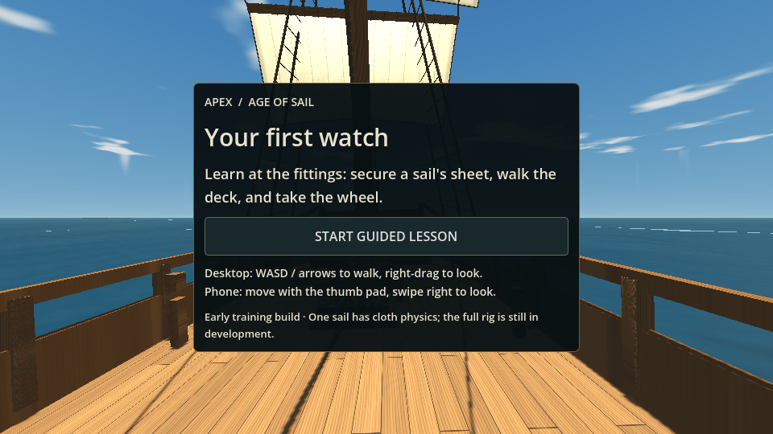
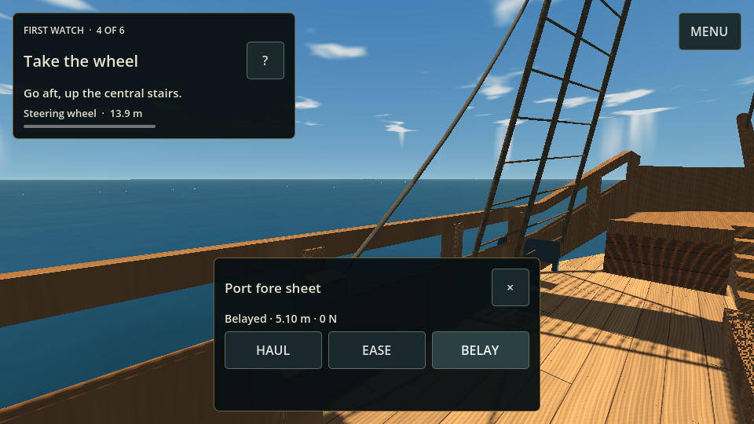
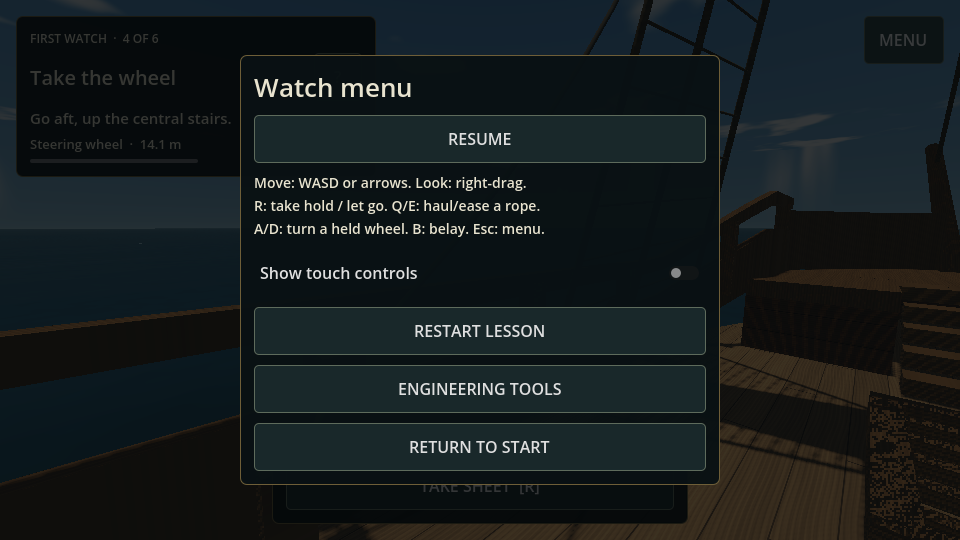
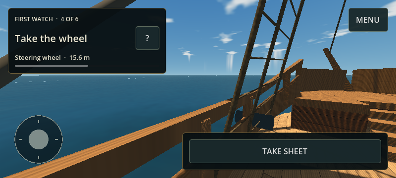

# First Watch: the first playable instruction sequence

Open the Web build normally and choose **START GUIDED LESSON**. The welcome screen also offers **ENTER VR** when WebXR reports support. Unsupported browsers keep ordinary desktop/touch controls; a headset browser is required for immersive VR. The watch menu contains **ENGINEERING TOOLS**; `?mode=workshop` also opens that development workspace directly. Explicit force-trial links retain their existing workshop behavior.

The lesson runs the existing force simulation in Calm weather. Starting/restarting resets practice flooding and repairs the lesson ropes and steering connection without duplicating fittings. Walk beside the marked port fore sheet and use its pin; haul at least 12 cm of actual paid-out rope, then belay it. Walk aft, climb the central quarterdeck stairs, and use the wheel. Apply starboard effort until the solved rudder reaches 5°, then counter-steer within 2° for 0.8 seconds. Merely pressing a button or stopping a pull does not award these steps. This introduces fittings and their operation; it does not certify sailing competence or teach a complete maneuver under way.

## One mechanism, two control adapters

| Fitting | Desktop / touch | Optional WebXR |
| --- | --- | --- |
| Walk and look | WASD/arrows or a touch thumb pad; right-drag or swipe open right side | Thumbstick walk and tracked head pose |
| Use a station | Stand on its deck within 1.65 m horizontally; Use / R | Reach within 40 cm of its pin, or near the wheel rim; squeeze |
| Wheel | Hold Port / A or Stbd / D; finite ±120 N m effort | Squeeze rim and turn hand; bounded ±129.6 N m effort |
| Rope | Hold Haul / Q or Ease / E; existing finite-force rope solver | Pull hand away from the fixed lead to haul; feed toward it to ease |
| Secure rope | Belay / B | Trigger beside the actual pin |
| Leave | Leave / R; walking away releases hand-held rope and wheel effort | Release grip; hand-held ropes run free unless belayed first |

Positive helm effort is starboard. The visible wheel now turns clockwise for that direction when viewed from aft, and VR hand-angle conversion uses the same convention. Releasing the wheel requests zero hand torque, allowing the transmission to backdrive; it does not lock a commanded rudder angle.

Five physical stations use this adapter: wheel, port/starboard fore clew sheets, and port/starboard lower foreyard braces. The desktop proximity restriction prevents use through the quarterdeck floor and releases controls on leaving reach or entering another view. It is a local interaction rule, not network security: CrewSession still arbitrates exclusive network station ownership, and its workshop/VR command paths are retained. The introductory lesson itself is currently solo. Networked instruction/progression is not implemented.

VR adds nearby hand prompts, a lesson/readout at the relevant fitting, plus co-op command feedback. The training prompt follows the fitting rather than the headset. The lesson recognizes a physical VR grip through the existing adapter. No controller emulation is presented as headset acceptance. Real headset reach, comfort, room-scale collision, controller mapping, haptics and frame rate remain unverified.

## Visual changes and limits

Three original deterministic 512 px seamless grayscale maps now provide timber grain, linen fibers/soiling and hemp detail. `tools/generate_ship_materials.py` regenerates them with NumPy and Pillow. Existing surface colors, plank caulking, wetness and canvas seams remain, with derivative bump detail that also works on the generated meshes without tangents. Daytime direct/ambient light is reduced to retain surface detail.

Each of the eight sails has a visible bolt-rope border and head lashings. The lower fore sail's border follows its current deformed mesh; the other seven retain their existing visual sail meshes. These borders/lashings are cosmetic attachments, not an additional mass, contact or rope solver. Original source GLB bytes remain unchanged. Most running rigging, tacks, all-sail cloth, detailed block/sheave mechanisms, measured materials and final art are still outstanding.

## Verification

`tests/sailing_lesson_test.gd` traverses real deck collisions and the quarterdeck stairs, exercises load-driven shortening and belay, moves and centers the solved rudder, rejects distant/through-floor operation, and checks VR station prompts/grip-to-lesson mapping. It does not teleport between lesson stations. `tests/browser_lesson.cjs` uses the exported game's real welcome, camera, nearby sheet approach, haul/belay and distant-wheel rejection; saved screenshots include portrait layout. `APEX_FULL_LESSON=1` additionally exercises the long browser walk and rudder centering; the complete route is always covered by the native suite. The browser flow also exercises the watch menu, touch-control switch, simultaneous move/look and one-finger release. Other native/transport/browser regressions continue to cover the existing ship.

`tools/package_web_preview.py EXPORT OUTPUT` makes an optional static-host package of the same Godot export. It splits the original engine into chunks below the host's 25 MiB per-file limit and streams those identical bytes into the normal Godot loader. Gameplay remains in Godot. `build-info.json` records engine hash and source commit. This packaging does not publish or merge the GitHub project.

## Deliberate interface states

The walking view has a compact task card, progress, optional explanation and one menu entry. It shows no station panel when no fitting is reachable. Approaching a fitting offers Take hold; grasping it exposes only its wheel or rope actions and a Let go target. The phone uses a finger-owned move pad with independent right-side look. Desktop walking additionally supports WASD while outside a held station.

Explanations open as a focused modal. The watch menu pauses the solo world and stops held input; resume preserves the lesson. Restart, XR entry, input help and engineering tools live there rather than across the walking view. Start/menu content scrolls on small displays. `trainer_ui_test.gd` checks 48 viewport/input/state combinations, target sizes, clipping/overlap, modal behavior and touch ownership, including real touch superseding emulated mouse input. Passing these checks does not establish real-device usability or full realism. See [the canonical prerequisites](../SIMULATION_REALISM_REQUIREMENTS.md).

The small-landscape image is browser emulation, not a physical Android test. The touch regression measures a 40 px right-side drag as a 0.16 rad yaw change; initial browser-relative deltas are not trusted. Captured fingers release independently, including when ending over a control. View changes and resizing settle through owned frame countdowns, which cannot resume after their scene has been freed.
