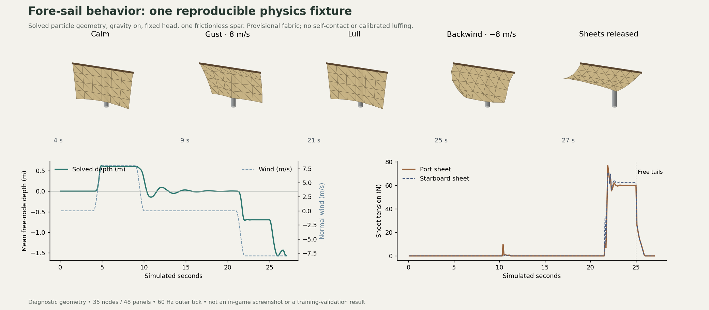

# Fore-sail stage: rest shape and spar contact

This stage removes permanent billow from the lower fore membrane's rest constraints and introduces frictionless triangle/capsule contact. Wind loads produce the shape; a lull unloads it with gravity still on. This is a completed numerical increment toward the fore-sail circuit, **not completion of the whole circuit or any full realism gate**.



## Changes in the ship

The membrane's 35 nodes and 48 pressure triangles now start from a planar trapezoidal cut pattern. The mass budget follows that rest area: approximately 8.31 kg at the provisional 0.6 kg/m². Seven other sails still use fixed pressure surfaces and cosmetic flutter.

The imported lower foreyard's center originally passed through the foremast axis. Its mesh now sits 0.40 m forward of that axis, retaining the mast-axis brace pivot. The two physical brace endpoints, rope rendering and lever arms follow the relocated spar. The head is fixed just ahead of its forward face, using dimensions from the actual spar mesh. Visible head loops are centered around that spar; those loops remain cosmetic.

`sail_contact.gd` checks each membrane triangle against analytic capsule envelopes derived from the three mast and eight yard meshes. It detects capsule crossings inside a coarse panel as well as near edges/vertices. Corrections use barycentric weights and inverse mass; the fixed head cannot be moved by contact. The caller must place fixed attachments clear. Capsule coordinates follow the interpolated hull or loaded yard. The same solved particles drive the mesh, pressure panels and network snapshot.

Contact response remains in the existing single hull support resultant: external wind/gravity minus the cloth momentum change. Yard-envelope contact also contributes to the loaded yard's torque. No second copy of the cloth pressure or contact resultant is applied to the hull.

Explicit squared-velocity drag could amplify the large relative velocities from a contact correction. Substep pressure now averages an analytic local quadratic-drag relaxation, with canvas areal mass in its denominator. `pressure(wind, reef, 0)` still returns instantaneous diagnostic pressure. This patch approximation stabilizes the numerical coupling; it is not a resolved or calibrated airflow model.

## Reproduce the evidence

Run with Godot 4.7.2:

```sh
godot --headless --path . --script res://tests/sail_contact_test.gd
godot --headless --path . --script res://tools/probe_sail_cycle.gd
python3 tools/plot_sail_cycle.py
```

The [trace and particle snapshots](fore-sail-cycle.json) record the source hashes, engine, 60 Hz outer tick, normal gravity, fixed head and one frictionless spar. A one-second smooth wind ramp joins each phase. These are isolated numerical measurements, not screenshots of validated vessel handling.

| Phase end | Mean free-node depth | Sheet behavior |
| --- | ---: | --- |
| Calm, 4 s | 0.000 m | Free/slack, zero tension |
| Gust, 9 s | +0.604 m | Actual spar contact, free sheets |
| Lull, 21 s | +0.002 m | Gravity on; kinetic energy about 0.00016 J |
| Backwind, 25 s | −0.695 m | Belayed sheets carry approximately 60 / 63 N |
| Release, 27 s | −1.567 m | Free tails pay out; tension returns to zero |

The numerical contact regression checks panel-interior piercing, degenerate panels, calm/gust/lull/backwind, less than 3 mm penetration in its specified 10 m/s spar fixture, momentum accounting, settling after contact and 60/120 Hz agreement within 3 cm. Scene checks bind all 11 spar envelopes, verify head clearance, move the hull/yard and compare rendered faces with solved particles. These tolerances describe these fixtures, not all loads or arbitrary initial overlaps.

All eleven native suites pass locally, including construction, force trial, braces, cloth, environment, VR input math, full first-watch lesson and responsive controls. The real host/two-client co-op check passes, including remote sheet operation and disconnect release. The exported browser cloth test hauls the real sheet by over 8 cm and verifies belay/free/cut without page errors. GitHub CI repeats the native and browser gates.

The successful yard-maneuver regression now explicitly eases the clews and uses light wind. It waits for measured yard travel. One hand's 180 N limit cannot guarantee bracing against tightly belayed clews under every loaded wind direction; the separate overload/slip checks retain that behavior.

## Still open

No self-contact, deck/rope contact, continuous swept collision, contact friction, calibrated folds/luffing, seam/tear mechanics or sail-to-sail airflow. Capsule envelopes approximate spar surfaces, including rounded ends; they do not reproduce exact tapered timber geometry. Moving obstacles are sampled at solver substeps, so arbitrary high-speed crossings are not accepted.

Fore tacks, yard support/lifting gear, clewlines/buntlines, physical reefing/furling and the complete line inventory remain unfinished. Headset reach, stereo behavior, room-scale collision, haptics and device performance still require actual hardware validation. [R4/R5 and the full readiness checklist](../../SIMULATION_REALISM_REQUIREMENTS.md) remain open.
