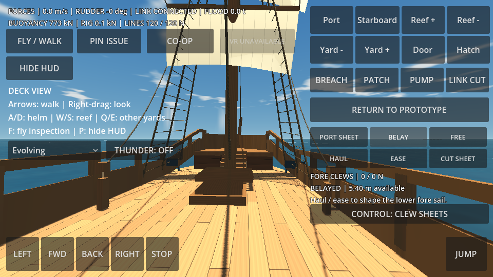
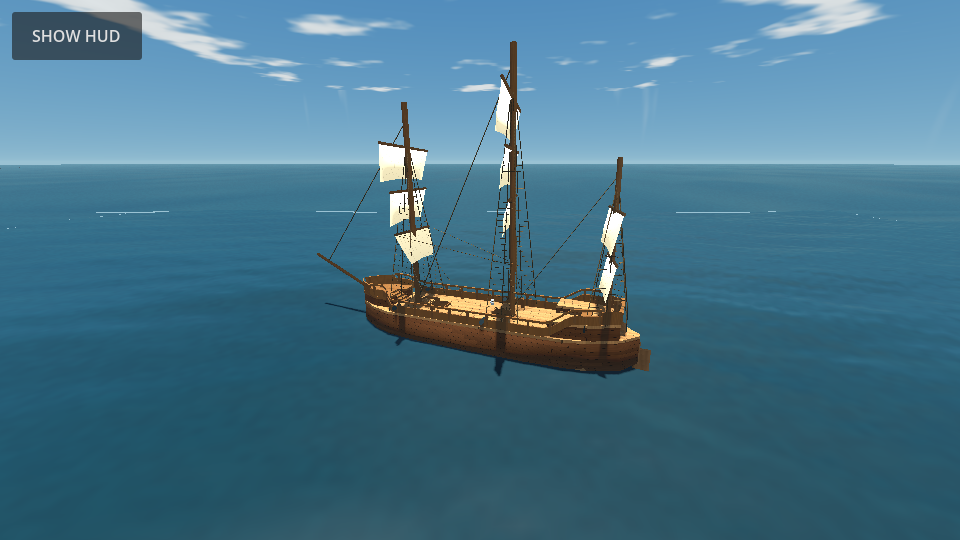

# Lower fore sail: membrane and clew-sheet trial

PHYSICS TRIAL now solves the original lower fore sail as a deforming membrane. Its head follows the pressure-loaded foreyard; two sheets restrain its clews through fixed bulwark blocks and deck pins. Changing a sheet's available length changes its constraint on the sail. Seven other sails retain their pressure-only approximation. The existing wheel, first-person trainer, brace circuit and wider APEX game remain intact.

## Operate the circuit

Enter **PHYSICS TRIAL**, then choose **CONTROL: CLEW SHEETS** below the rig status. Select **PORT SHEET / STBD SHEET**. Hold **HAUL** or **EASE**, then **BELAY** to fix the available length. **FREE** lets the tail run under load; **CUT SHEET** removes its load and rendered connection. The selector switches back to the yard braces. A free sheet may already be slack; a load requires wind pulling its clew away from the block. The displayed tensions make that distinction visible.

The top **Yard − / Yard +** buttons and Q/E still trim the other yards through the simplified control. W/S and Reef ± scale effective aerodynamic area; they do not physically gather this membrane into reefs. Selecting another circuit stops active hauling commands. In co-op, the two sheets have separate exclusive stations, using the same ownership, effort limits and disconnect cleanup as braces. One participant can own one station at a time. The host solves the membrane and replicates its shape and sheet state; clients do not solve a competing sail.

Optional WebXR uses grip near the sheet pin to haul/ease, release to free, and trigger near the pin to belay. This adapter has software checks only; headset reach, stereo rendering, comfort and frame-rate acceptance remain pending.

## Model and load transfer

`sail_membrane.gd` is a scene-independent `RefCounted` solver with 35 world-space nodes and 48 pressure triangles. Six-by-four panels use structural, diagonal shear and softer two-edge bending distance constraints. XPBD iterations account for compliance through the squared substep duration. Physics ticks are subdivided to at most 1/240 second, with six constraint iterations. This is a low-resolution fabric approximation; it does not reproduce a measured canvas weave or a complete shell bending law. The numerical approach follows [Macklin, Müller and Chentanez, XPBD (2016)](https://mmacklin.com/xpbd.pdf); no external implementation was copied.

Defaults are provisional: 0.6 kg/m² canvas (about 8.53 kg on this sail), structural compliance 0.00001 m/N, shear 0.0002 m/N, soft bending 0.02 m/N and velocity damping relative to the moving support of 0.7/s. Top-strip mass is lumped onto the nearest free row. Every head node is kinematically attached to the moving yard. Gravity and two-sided normal pressure act on the particles. Pressure uses each deformed triangle's area, normal and mean particle velocity, air density 1.225 kg/m³ and coefficient 0.8. Backwind reverses the pressure. This is pressure drag, not calibrated lift, circulation, sail shadow or resolved airflow.

Each sheet is a unilateral compliant distance constraint: clew-to-block distance plus fixed block-to-pin tail cannot exceed paid-out length without tension. Slack ropes cannot push. Belaying fixes length. Hand operation targets ±0.35 m/s with at most 180 N, and overload can pay out through the hand. A free tail has a 2 kg generalized effective inertia and damping; exhausting its reserve lets the end run out. Sheet compliance is 0.00005 m/N. Turning blocks are ideal single-part leads. The tail's inertia is a scalar approximation, not a spatial simulation of rope segments, knots or moving rope mass. Visible slack is a sag approximation.

The membrane replaces the lower fore sail's old rigid pressure contribution in the hull force loop. It returns **external pressure and gravity minus its linear/angular momentum gain** as the support reaction applied to the hull. Thus pressure is not applied twice. Top-edge constraint reactions provide the yard hinge torque; sheet loads route to the hull fittings. Yard rotational-inertia reaction is still applied separately. The provisional 80,000 kg rigid assembly excludes this separately integrated canvas; seven fixed sails remain in that assembly. The initial displacement estimate includes the added canvas mass. All masses, coefficients and yard inertia still need a surveyed vessel budget and calibration.

The simulated sail uses the same vertices for rendering and pressure. Shader-only flutter is disabled on this sail's separate material; the other sails retain their existing visual flutter. Membrane and sheet geometry refresh at 10 Hz while mechanics solve at the physics rate. Protocol **2** carries body-local deformed points and sheet state; clients attach them to their interpolated hull pose. Both host and clients must use this version.

## Reuse contract

Copy `scripts/sail_membrane.gd` into a Godot project. `configure(bounds, head_z, initial_mesh_pose, leads, pins, fixture_pose)` builds the panel topology and initial line lengths. Bounds/head are mesh-local; leads/pins are rigid-body-local; poses are unscaled world transforms. `step(dt, mesh_pose, wind_world, effective_area, world_com, world_yard_hinge, fixture_pose)` returns support force/moment, aerodynamic force, top-edge moment and canvas mass in SI units. Advance only on the authority. Apply the returned support resultant once, excluding any prior pressure contribution for this sail. The caller must account for the canvas separately from rigid-body mass.

`build_mesh(mesh_world_pose)` produces the deformed ArrayMesh; `snapshot(body_pose)` and `receive_snapshot(data, body_pose)` translate geometry between world and hull-local coordinates. `set_hand`, `belay`, `release` and `cut` address sheet 0 or 1. Node/line state belongs to each instance. The pinnace adapter supplies fixtures, rendering, controls and hull integration; none of those are dependencies of the numerical core.

## Evidence and remaining work

The native membrane suite verifies head attachment, billow/backwind, loaded-sheet tension, payout, finite effort, overload slip, belay/cut behavior, unpowered decay, 60/120 Hz convergence, linear/angular load accounting, moving supports in gusts, uniform ship/air translation, snapshot transforms and actual scene/UI integration. Existing construction, force trial, braces, environment, first-person and Spatial QA regressions pass. VR adapter tests pass without headset acceptance. The three-process co-op test additionally hauls and belays a remote sheet, receives deformed points and checks disconnect release after a stalled receiver. A delayed-upgrade test checks a 4.2-second connection stall against the bounded 15-second handshake allowance. Browser checks operate the real selector/haul/belay/free/cut buttons in the Calm scenario, waiting for measured shortening from the physics loop while the selected sheet is in hand. They use a bounded deadline and inspect solved line travel. Active hauling exposes line lengths, modes, pulls, tensions and hand effort for diagnostics, and browser failure reports are retained. Gust/overload behavior is checked separately by native numerical tests; a local run shortened the selected sheet from 5.65 m to 5.40 m with no page/console errors. A separate two-browser host test checks shared controls.

Full running rigging remains open: fore tacks, lifts, halyards, buntlines/clewlines, reefing/furling, tackle purchase/friction and every other sail. There is no cloth self-collision, contact with spars/masts/rigging, tearing, stitched seam failure, knot/recoil model or sail-to-sail aerodynamic interaction. Clearances and loss-of-control scenarios need these before instructor-validated sailing lessons. Fabric/handling calibration, resolution/performance budgets on Android/headsets and long network/load testing are also unfinished. This is one coupled operating circuit, not a finished real-world sailing simulator or a packaged complete-ship asset.
