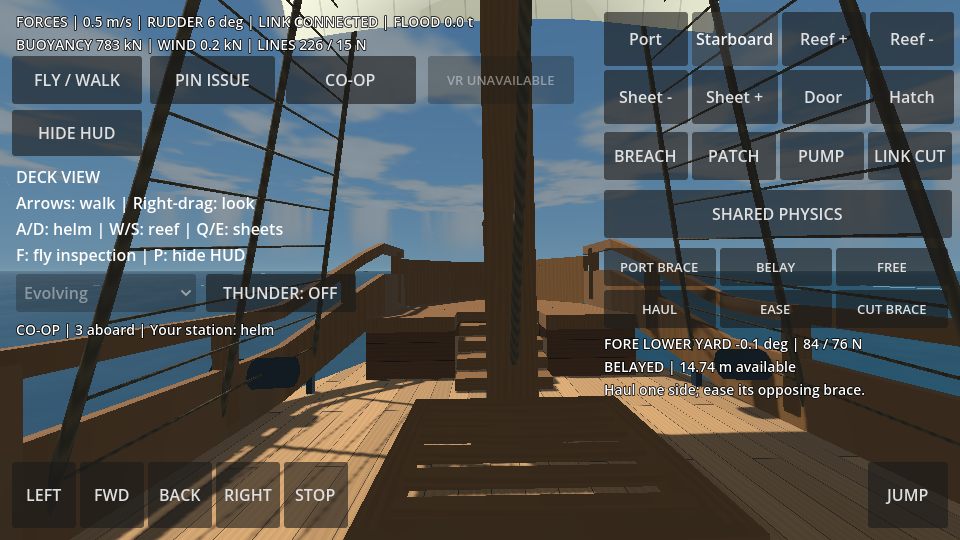
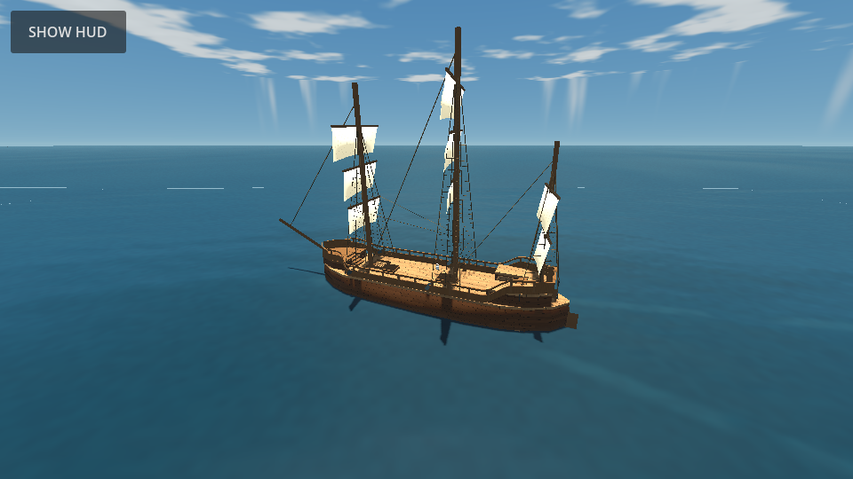
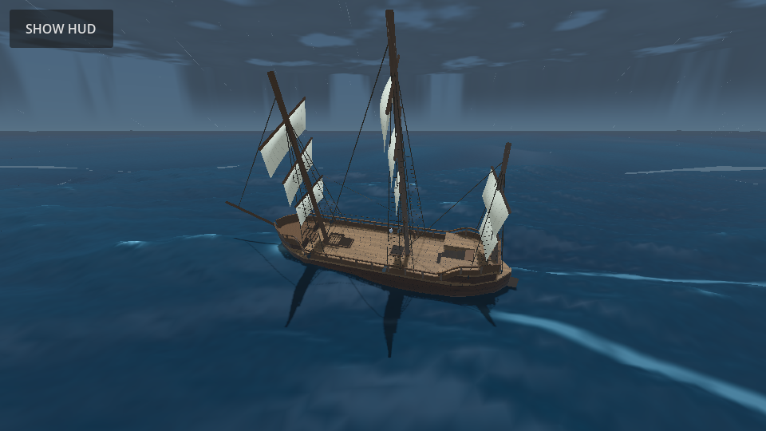

# Shared sailing simulation: environment, crew and optional VR

The target is a first-person sailing trainer with optional VR and a reusable complete ship, while preserving APEX's wider game. This change adds a shared procedural sea/weather field, a working co-op transport and station model, and an experimental WebXR control adapter. It does not complete every part of historical sailing, cloth mechanics or training validation.

## Crew and the two-player mode

The Australian National Maritime Museum describes Duyfken as about 25 m long, 6 m wide and crewed by approximately 20 sailors. That is a useful comparison for the retained 26.2 m hull envelope and 6.9 m beam, not identification of this ship or a demonstrated minimum crew. Voyage complement includes watches and work beyond an instantaneous sailing maneuver. [Museum source](https://www.sea.museum/1606-contact-at-cape-keerweer).

The near-term game mode is **two human players with assistance**: one can steer while another works a brace, with the existing simplified sail controls handling the rest. There are no autonomous AI deckhands yet. Extra participants can take port/starboard braces, sail controls, deck fittings and pumps. The code caps a session at 20 connections, including the host; only one host plus two clients has been tested. This cap is not a performance or historically necessary-crew claim.

## One world, one simulation

The native Godot host owns hull physics, flooding, sail/steering state, weather and the sea clock. Clients send bounded commands and movement input. They freeze their replicated hull and interpolate authoritative state, so two browsers cannot independently solve and disagree about the same ship. Server-side character bodies validate deck movement; clients predict locally and receive corrections. Remote crew currently appear as capsule placeholders.

Commands reserve one exclusive station per participant: helm, sail controls, a particular brace or clew sheet, deck or pumps. Claiming another free station releases the old one. Conflicting input is rejected with visible feedback. Disconnect or more than two seconds without input releases station ownership: an unheld wheel can backdrive, and an un-belayed hand-held line runs free; an already belayed line stays secured. The host alone can change the weather and create training breaches/patches. A command allowlist, finite-value checks, effort limits and input-rate limit constrain remote input.

Snapshots use protocol version 2 and carry the current pose/velocities, mass/COM/inertia, helm, brace and clew-sheet states, deformed lower-fore cloth points, openings, compartment water, crew positions, stations, weather and sea time. Each client acknowledges a snapshot before the host sends its next latest state. This bounds obsolete reliable snapshots when a browser stalls. A real two-browser test initially exposed buffer overflow; the acknowledgment change removed those errors. The native integration test also deliberately stalls a receiver for 2.6 seconds.



### Run a private co-op session

Restore/import the project as described in the README, then run a native host:

```sh
godot --headless --path /path/to/apex-age-of-sail -- --serve=9080
```

Serve the Web export, open it on each device, select **CO-OP**, enter the running host's WebSocket address and press **JOIN**. `ws://127.0.0.1:9080` is for a browser on the host machine. A separate device needs the host's reachable LAN address. **HOST LAN** is available in native builds; browsers join rather than listen for incoming connections. **RELEASE STATION** makes a station available to another sailor. **LEAVE** returns to local control.

This is a private-session prototype, not a deployed Internet lobby. An HTTPS game page needs a reachable secure `wss://` endpoint; this repository does not provision that endpoint, certificates, room authentication, a relay or matchmaking. Voice chat, reconnect/resume, full avatar animation, replicated tracked hands, host migration and 20-person load acceptance remain open. Network transport is reliable WebSocket, suitable for this initial training slice; latency and bandwidth budgets still need physical-device measurement.

## Shared irregular sea

`sea_spectrum.gd` is a reusable, seeded directional wave field. Sixteen components combine four longer swell bands with twelve shorter wind-wave bands, randomized directions/phases, and traveling amplitude groups. Each obeys deep-water gravity-wave dispersion, `ω² = gk`. Horizontal steepness is bounded to avoid folding the parameterized surface. Analytic derivatives include the packet envelope, supplying normals, horizontal Jacobian and material water velocity.

The ocean shader receives the same component data, phases, clock, scale and choppiness as CPU sampling. The previous shader-only wind amplitude multiplier is removed. Hull water resistance now acts on point velocity relative to sampled water velocity, with interpolation from a small flow grid. CPU inverse coordinates account for horizontal displacement when finding the rendered water height.

Foam is a visual approximation driven by surface compression and a reconstructed earlier crest, broken up by advected world-space noise and fine bubble variation. It includes a speed-dependent wake and bow froth. It no longer paints every high wave as a broad white strip. Coarse horizon geometry fades crest foam instead of stretching isolated crest samples across distant polygons. The rendering uses a rough dielectric sea with restrained highlights, replacing the earlier cyan glare. Foam is not a persistent fluid volume or a resolved breaking-wave solver.





## Generative weather and effects

`weather_field.gd` is a scene-independent seeded field sampled by position and simulation time. Advected noise supplies fronts and humidity variation; smaller-scale noise supplies gusts and veering wind. State includes wind, storm strength, humidity, cloud cover, rainfall in mm/h, visibility in metres, pressure in hPa and temperature in °C. Its relationships are explicit training approximations, not a calibrated atmosphere/forecast solver.

The controller feeds that state to sail pressure, lagged sea amplitude, ship wetness, procedural sky/cloud cover, lighting, rain and distance fog. Sea response has a 35-second relaxation time rather than changing instantly with a gust. The sun/day clock is independent of the weather field; its default accelerated cycle is 24 minutes. Lightning is seeded and rain-gated, with optional synthesized thunder delayed after a flash. Thunder audio starts only when enabled. Ambient wind/rain audio, spray particles and precipitation collision are not implemented.

The weather selector offers **Evolving, Calm, Breeze, Squall, Storm**. Scenario changes blend; `?simulation=forces&weather=Storm` starts a Web review directly in the chosen sea/weather state. In co-op, the host selects the weather and clients receive it. The sky and rain use procedural shaders and instancing rather than the old repeated cloud-sphere banks. Clear, cloudy, rainy, fog-reduced-visibility and electrical-storm appearances are covered. Snow, ice, tropical-cyclone dynamics, geography/fetch, bathymetry, shoreline breaking and physical atmospheric thermodynamics remain future work.

NOAA's [Beaufort descriptions](https://forecast.weather.gov/glossary.php?word=scale) distinguish glassy wavelets, scattered whitecaps, increasing spray and wind-blown foam; its [marine observing guide](https://vos.noaa.gov/docs/marine_info_guide.pdf) distinguishes swell from local wind waves. Those guide the qualitative behaviors, not validated numerical sea-state calibration.

## Optional WebXR prototype

Desktop/touch remains the starting mode. The **ENTER VR** button appears enabled only when WebXR reports immersive-VR support; unsupported browsers keep the normal trainer. Entry happens on a user gesture. The adapter creates an XR origin at the deck player's feet, a tracked camera and controller nodes. A comfort-horizon setting keeps the view upright; it can instead follow the ship's full basis.

Grip near the wheel rim requests bounded spring/damping torque from hand rotation; it never imposes a wheel angle. Letting go removes hand torque. Grip near a brace or clew-sheet pin and move away from/toward the block to haul/ease through the existing finite-effort model. Release lets the line run; trigger at the pin belays. Tracking loss and session end release held input. Thumbstick locomotion uses the same deck controller. The same command adapter routes effort to the host in a co-op session.

Headless tests verify reach, torque bounds, release, rope gestures, origin placement and unsupported-device fallback. **No headset has been used to validate this implementation.** Controller profiles, stereo/multiview rendering, room-scale body collision, comfort, frame rate, haptics and joint multiplayer/VR presence require real hardware. This is not completed native OpenXR support or validated sailing instruction. See [Godot WebXR](https://docs.godotengine.org/en/4.7/tutorials/xr/webxr_intro.html).

## Verification and completion gates

Native suites cover construction, Spatial QA, force trial, deck trainer, loaded braces, environment and VR input. A separate three-process test runs one host and two real WebSocket clients, tests shared state, rejects competing/invalid input, checks disconnect cleanup and stalls a receiver. A real two-Chromium-client test joins the headless host through the UI and verifies both receive the same helm command, with no console/page or host errors after the queue fix. This is software-rendered emulation, not target-device performance acceptance.

| Area | Present | Remaining completion gate |
|---|---|---|
| Hull and water | Displacement, restoring moments, relative-flow damping, shared wave field | Surveyed mass/inertia and maneuvering calibration, slamming/free surface/capsize tests |
| Running rig | Loaded wheel, one two-brace yard and one deforming sail/two-sheet circuit | Other yards/sails, tacks, halyards, tackles, friction, cloth collision and measured calibration |
| Integrity | Compartment water and provisional breach/patch/pump controls | Opening graph, free-surface/air effects, structural connection/failure model |
| Environment | Seeded evolving atmosphere/sea, clouds, rain, fog, lightning/thunder, visual foam/wake | Calibrated sea states, persistent foam/spray, full precipitation/audio and geography |
| Co-op | Host authority, stations, crew movement/state, bounded snapshots | Hosted authenticated rooms, reconnect, voice/presence and target-device/load validation |
| Optional VR | WebXR session and controller-to-mechanics adapters | Real-headset acceptance, room-scale collision, haptics and native XR support |
| Education/resource | Documented controls and reusable numerical cores | Lessons validated by sailors, complete sample vessel, asset/dependency/license release inventory |

The [first sail-clew sheets and deforming membrane](sail-membrane-trial.md) are now integrated. The next dependencies are cloth/spar contact, tacks and expansion through the complete running rig. Public hosting and headset validation are separate delivery gates. A successful build alone does not mark these complete.
