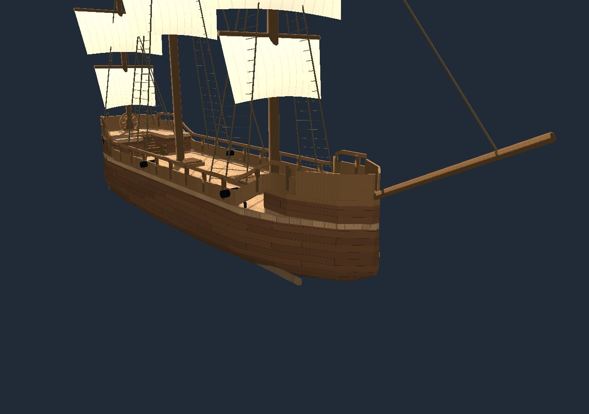
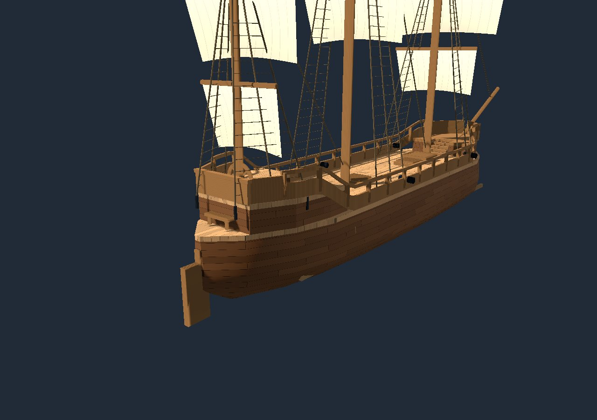
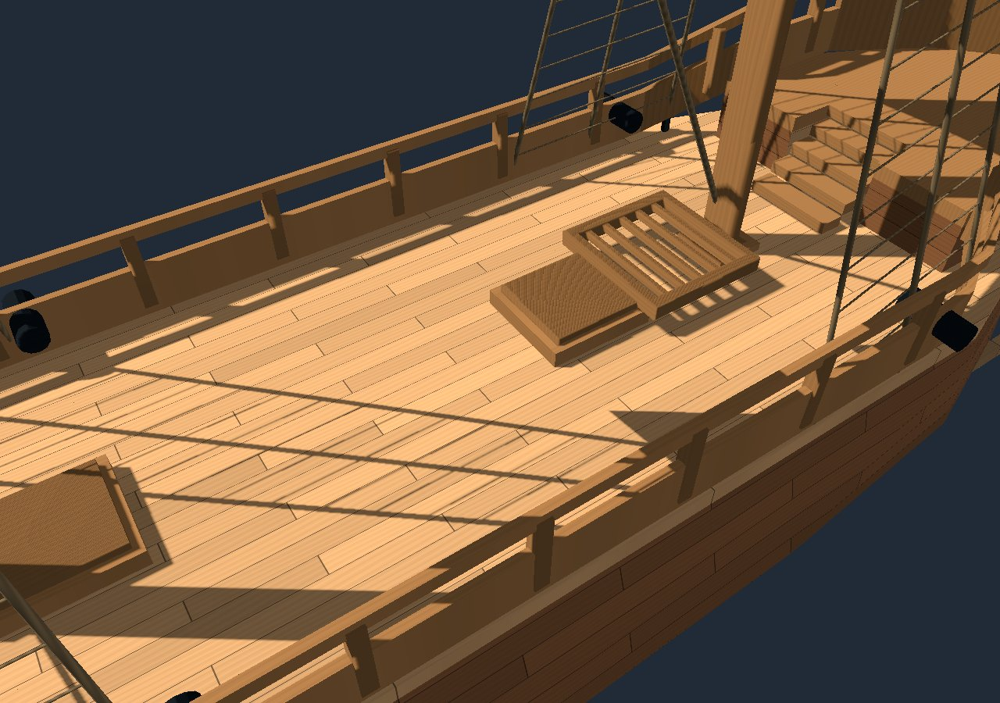
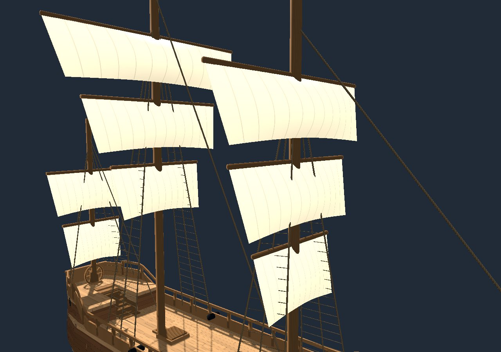

# Ship construction refit — October 28, 2026

This pass changes the actual APEX pinnace, retaining the source V9 GLB, its three masts, eight sail/yard pairs, deck layout and original fittings. It fixes measured construction defects rather than substituting a different vessel. The unmodified source GLB still restores to SHA-256 `a34a9b501de901a51871cef455d4c2bccd5bd924a73b03920c3b793c8316bfb6`.

## What was measured and changed

| Area | Before | Refit |
|---|---|---|
| Hull | V6 was already topologically closed; its elliptical roof did not meet the rectangular decks. Older open fairing-study hull also remained in the asset. | Reuses the eleven measured V6 stations, 6.9 m maximum beam, 26.2 m length and −2.2 m lower bound. Lower sections remain on those lines; topsides meet the tapered deck rim. Bow/stern faces and the raised-deck sides are enclosed. The superseded fairing hull stays hidden. |
| Decks | Three generations of main/raised decks overlapped, causing visible moiré and flicker. Rectangular ends overhung the narrowing hull. | Retains the solid-deck nodes, fits their footprints to the hull stations and hides the superseded deck surfaces. Main deck has real hatch openings; both raised decks have stair notches/landings and supporting sides. |
| Walk surfaces | Main deck collider top was 0.45 m against a visible 1.13 m deck; raised-deck colliders were similarly low. A broad hull box blocked the hold. | Convex deck cells share the render footprints, levels and openings. The broad interior-blocking box is disabled. Smooth stair collision ramps connect the visible main, quarterdeck and forecastle levels. Lower-deck planks/collision taper to the lower hull. |
| Masts/frames | Mast bottoms floated at 1.30 m, above the deck. Some constant-width frames projected through the narrowing ends. | Retains the 19/22/14 m mastheads and extends their original trunks/colliders to the keelson step at −1.26 m, with wooden deck partners. Original side frames follow the hull cross sections. |
| Helm/rudder | Hub and blade bases rotated baked ship-coordinate vertices about the vessel origin. The ring/spokes did not move as one wheel; multiple fixed rudder blades overlapped. | The original ring, eight spokes and hub share one measured axle pivot. One original blade and its shortened forward tiller share the stern hinge; superseded fixed blades are hidden. |
| Sails/yards | Eight ten-vertex solid sail wedges; trim rotated both parts around the ship origin. | Each original sail node receives a curved 16×12 cloth grid. Original head height/span/drop and yard meshes remain. Each pair shares a mast socket; head and endpoint attachment are tested across the trim range. Subtle leech flutter leaves the head pinned. |
| Standing rigging | Two generations of shrouds; several upper endpoints missed their mast centers. | Reuses six newer shroud meshes at measured mast collars, with three legs per side, ratlines and chainplates. Superseded shrouds are hidden; three stays lead to the bowsprit/forward mast feet. |
| Doors/hatches | Moving solid proxies overlaid the fixed original leaves. Door leaves did not match the bulkhead openings. | The original leaves and matching moving collision shapes rotate about actual hinges. Doors are fitted to the existing bulkhead frames. Open hatches reveal the lower deck rather than an invisible floor. |
| Materials | Shape heuristics classified the bowsprit/wheel as canvas and spars as cord. | Explicit fitting names precede geometric guesses. Exactly eight sails are canvas. Shared shaders give wood grain, staggered plank/caulking seams, iron, hemp and canvas panels, retaining weather wetness. Thin cloth casts deck shadows but skips shadow reception to avoid Compatibility-renderer self-shadow acne. |

## Rendered evidence

These are actual Chromium/WebGL renders of the changed game geometry and materials, isolated under fixed review lighting. They are not concept art, physical-device captures or a frame-rate benchmark.

## Validation

`tests/ship_construction_test.gd` checks the closed reference-envelope edge incidence and nondegenerate triangles, preserved hull bounds, eight original cloth/yard bindings, sail head/end attachments through both trim extremes, whole-wheel articulation, fixed rudder/door/hatch hinges, material identity, raycast deck alignment and hatch clearance. It also moves the actual CharacterBody up both stair routes and checks its feet against the visible deck levels.

The separate Spatial QA interaction regression remains in place. GitHub CI imports/exports the game, runs both native tests, then renders the browser game and saves/downloads a note attached to a real ship triangle. The public game is not changed by a draft-PR build.

## Practical limits and next construction work

The closed reference envelope encloses approximately **379.69 m³** under its deck datum. That test proves the reference geometry closes; it does not certify the assembled render meshes as globally manifold, derive a historical displacement, or change the existing 34 m³ prototype sailing model. Real hydrostatics, flooding coupling and mass distribution remain unfinished.

Cloth curvature/flutter and standing rigging are render/kinematic approximations, not tensioned rope or physical cloth simulation. Running braces, halyards, sheets and their blocks still need routing and load transfer. The inherited eight-square-sail plan is preserved; era-specific sail proportions and a lateen mizzen still require a documented vessel plan. The existing wheel is retained, not authenticated as correct for 1670–1690.

The two tested stair routes and hatch openings do not establish complete below-deck headroom/accessibility, fracture behavior or 30 FPS on Android. Physical Android acceptance remains pending. Ocean/sky defects are unchanged by this ship-focused pass.

## Technical references

- [Godot ArrayMesh: clockwise triangle winding and mesh arrays](https://docs.godotengine.org/en/stable/classes/class_arraymesh.html)
- [Godot spatial shaders: two-sided rendering and shadow reception](https://docs.godotengine.org/en/4.7/tutorials/shaders/shader_reference/spatial_shader.html)
- [Royal Museums Greenwich: seventeenth-century fighting vessel with lateen mizzen yard](https://www.rmg.co.uk/collections/objects/rmgc-object-135498) — a period reference, not a lines plan or authentication of this model.
